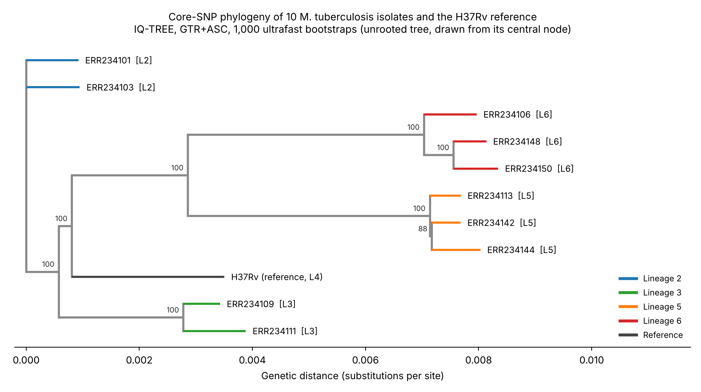

# M. tuberculosis core-SNP phylogeny

Academic project (bioengineering cycle, UM6SS, module *Genomics for bioinformaticians*): reproducible pipeline that reconstructs the phylogeny of **10 public *Mycobacterium tuberculosis* isolates** from raw sequencing reads, and checks whether they group by genetic lineage.

## Question
Do 10 isolates from 4 different lineages (L2, L3, L5, L6) group by lineage in a core-SNP phylogeny, as expected biologically?

## Data
- 10 public paired-end runs (Illumina HiSeq 2000) from the SRA/ENA, selected in BioProject PRJEB3223 (Comas et al., 2013), whose metadata give the lineage of each isolate:

| Lineage | Accessions |
|---|---|
| L2 | ERR234101, ERR234103 |
| L3 | ERR234109, ERR234111 |
| L5 | ERR234113, ERR234142, ERR234144 |
| L6 | ERR234106, ERR234148, ERR234150 |

- Reference genome: *M. tuberculosis* H37Rv (NC_000962.3, 4,411,532 bp, lineage L4).
- Raw reads are not included in this repository because of their size. The script downloads them from their public accessions (`isolate_list.txt`).

## Workflow
| Step | Tool |
|---|---|
| Download of public runs | SRA Toolkit (`prefetch`, `fasterq-dump`) |
| Trimming and QC | fastp (`--detect_adapter_for_pe -q 20 -l 50`) |
| Mapping and variant calling | Snippy (against H37Rv) |
| Core alignment | snippy-core |
| Variable sites only | snp-sites |
| Phylogeny | IQ-TREE (`-m GTR+ASC -B 1000`) |
| Tree visualisation and lineage colouring | iTOL / Python |

All commands are in [`run_pipeline.sh`](run_pipeline.sh).

## Results
- Core SNP alignment of **1,393 variable sites** across 11 sequences (10 isolates and the reference). Variant counts per isolate are in `results/core_snp/core.txt`.
- Maximum-likelihood tree (GTR+F+ASC, 1,000 ultrafast bootstraps). The ascertainment bias correction (ASC) is needed because the alignment contains variable sites only.
- **Each lineage forms its own well-supported clade** (bootstrap 100 on all major nodes, 88 on one secondary node inside L5): the 10 isolates group by genetic lineage, as expected.
- The method recovers the lineage structure from sequencing data alone, without prior knowledge of the lineages.
- The tree is unrooted and is drawn from its central node. Close genomic distance is not evidence of direct transmission, which would require epidemiological metadata.

## Repository content
- `run_pipeline.sh`: the full pipeline
- `isolate_list.txt`: accession numbers
- `tree_mtb10.png`: phylogenetic tree coloured by lineage
- `results/core_snp/`: variant summary per isolate (`core.txt`) and core SNP alignment (`core_filtered.aln`)
- `results/tree/`: tree files (`mtb10.treefile`, `mtb10.contree`), IQ-TREE report and iTOL annotation

## Perspectives
- Root the tree with an outgroup (e.g. a lineage 1 isolate) to study the relationships between lineages.
- Mask the repetitive PE/PPE gene families before the core alignment to refine SNP counts.
- Confirm lineage assignment independently with TB-Profiler.
- Turn the manual workflow into a Snakemake pipeline for full reproducibility.

## My role
Individual academic project: I designed and ran the workflow end to end (data retrieval, quality control, mapping, core-SNP alignment, phylogenetic inference) and interpreted the results.
